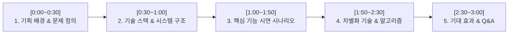

# 🎤 SpendWise 3분 발표 자료 및 대본 (PRESENTATION.md)

---

## 1. 발표 개요
- **발표 주제**: 개인 소비습관 정밀 분석 웹 서비스 **SpendWise**
- **발표 시간**: 3분 (180초)
- **발표자**: SpendWise 개발팀
- **핵심 메시지**: "기록만 하는 가계부를 넘어, 실제 데이터 기반의 100점 만점 소비습관 진단과 선제적 예산 경고로 사용자의 재무 건전성을 지키는 핀테크 플랫폼"

---

## 2. 3분 발표 타임라인 & 슬라이드 구성

---

## 3. 슬라이드별 발표 대본 (정확한 3분 스크립트)

### 📌 [0:00 ~ 0:30] 슬라이드 1: 도입 및 문제 정의 (30초)
**[슬라이드 내용]**
- **서비스명**: SpendWise (스펜드와이즈)
- **슬로건**: "내 소비의 사각지대를 밝히는 실시간 금융 습관 주치의"
- **기존 문제**:
  - 간편결제와 배달앱으로 인한 무의식적 소비 급증
  - 단순 지출 내역 나열에 불과한 기존 가계부
  - 월말 카드값 확인 후에야 후회하는 사후적 통제

**[발표 대본]**
> "안녕하십니까, 개인 소비습관 분석 웹 서비스 **SpendWise** 발표를 맡은 OOO입니다.  
> 여러분은 지난달 커피값이나 배달팁으로 얼마를 썼는지 정확히 기억하십니까?  
> 많은 분들이 월말 카드 명세서를 보고 깜짝 놀랍니다. 현대인은 간편결제로 인해 '어디서 돈이 새는지' 모른 채 소비 통제력을 잃고 있습니다.  
> 기존 가계부는 단순한 기록장에 불과했습니다.  
> 저희 **SpendWise**는 임의의 통계나 추측이 아닌, **실제 금융 데이터에 기반하여 나의 소비습관을 100점 만점으로 진단하고, 70%·90%·100% 단계별 경고를 통해 사전에 과소비를 막아주는 지능형 핀테크 플랫폼**입니다."

---

### 📌 [0:30 ~ 1:00] 슬라이드 2: 기술 스택 및 아키텍처 (30초)
**[슬라이드 내용]**
- **필수 스택 100% 준수**: Node.js, Express, EJS, MySQL2, MySQL, Chart.js, bcrypt, express-session, dotenv (React/Vue 미사용)
- **아키텍처**: Router - Controller - Service - Model - Database의 5단계 계층 분리
- **보안**: bcrypt 단방향 암호화, SQL Injection 방지를 위한 100% Prepared Statements

**[발표 대본]**
> "본 서비스는 요구조건에 명시된 필수 기술 스택만을 엄격히 사용하여 순수 Node.js와 Express, EJS 템플릿 엔진으로 구축되었습니다.  
> 아키텍처는 엔터프라이즈급 설계를 적용하여 라우터, 컨트롤러, 서비스, 모델을 철저히 분리했습니다.  
> 특히 비즈니스 로직과 수학적 통계 계산을 `Service` 계층으로 캡슐화하여 유지보수성과 확장성을 극대화했습니다.  
> 보안 측면에서는 회원 비밀번호를 `bcrypt`로 암호화하고, 모든 DB 쿼리에 `Prepared Statement`를 적용하여 SQL Injection을 원천 차단했습니다."

---

### 📌 [1:00 ~ 1:50] 슬라이드 3: 핵심 기능 및 시연 시나리오 (50초)
**[슬라이드 내용]**
- **① 다크모드 대시보드**: 월별 수입·지출, 순저축, 6개월 추이 막대차트, 카테고리 도넛차트
- **② 단계별 예산 경고**: 70% 주의(노랑), 90% 경고(주황), 100% 초과위험(빨강) 실시간 배너
- **③ 월말 예상 지출 계산**: 경과 일수와 일평균 소비 추세를 결합한 예측 모델
- **④ 소비습관 100점 진단**: 4대 영역별 점수와 산출 근거를 담은 레이더 차트
- **⑤ 과소비 & 소액결제 탐지**: 10만원 이상 고액 결제와 1만원 이하 반복 지출(티끌 누수) 자동 포착
- **⑥ 절약 챌린지**: 원클릭 저축 반영 및 실시간 달성률(%) 트래킹

**[발표 대본]**
> "핵심 기능을 시연 흐름에 따라 설명드리겠습니다.  
> 사용자가 로그인하면 **핀테크 감성의 세련된 다크모드 대시보드**가 펼쳐집니다.  
> 상단에서는 이번 달 수입, 지출, 저축액뿐 아니라, 현재 소비 속도대로라면 이번 달 최종 지출이 얼마가 될지 알려주는 **'월말 예상 지출액'**이 표시됩니다.  
> 예산 사용률이 70%를 넘어서면 노란색 주의 배너가, 90%에 달하면 주황색 경고 배너가 나타나며, 100%를 초과하면 위험 배너가 즉시 소비를 경고합니다.  
> **'소비 습관 진단'** 메뉴로 들어가면, 사용자의 실제 거래 내역을 바탕으로 산출된 **100점 만점 소비점수(예: 79점, 양호 등급)**와 함께, 예산 준수도 35점, 저축률 25점, 과소비 억제도 20점, 소액결제 관리 20점의 4대 영역별 상세 점수와 평가 근거가 레이더 차트로 시각화됩니다.  
> 또한 **'소비 패턴 분석'**에서는 10만 원 이상의 고액 과소비 건과, 1만 원 이하의 카페·편의점 등 반복 소액결제를 정밀 탐지하여 '티끌 누수'를 한눈에 파악할 수 있습니다."

---

### 📌 [1:50 ~ 2:30] 슬라이드 4: 차별화된 핵심 알고리즘 (40초)
**[슬라이드 내용]**
- **월말 지출 예측 수식**:
  $$\text{Expected Expense} = \text{누적 지출} + \left(\frac{\text{누적 지출}}{\text{경과 일수}} \times \text{남은 일수}\right)$$
- **100점 습관 점수 채점 엔진**:
  - 임의의 난수나 고정값이 아닌, 실제 MySQL 원장 데이터 실시간 집계
- **자동화 검증**:
  - 22개 단위/통합 테스트 + 11개 HTTP 엔드포인트 테스트 100% 통과

**[발표 대본]**
> "SpendWise의 가장 큰 기술적 차별점은 **'100% 실제 데이터 기반의 수학적 분석 알고리즘'**입니다.  
> 시중의 많은 프로토타입 앱들이 임의의 난수나 가짜 점수를 띄우지만, 저희 서비스는 거래가 추가·수정·삭제될 때마다 실제 일평균 지출액을 재계산하여 월말 예상 지출을 과학적으로 외삽합니다.  
> 또한 4대 평가 영역의 채점 로직은 금융 공학적 가중치를 부여하여, 저축률이 떨어지거나 잦은 소액결제가 발생하면 점수가 즉시 하락하도록 설계되었습니다.  
> 이 모든 로직은 22개의 단위·통합 테스트와 11개의 HTTP 종단간 테스트를 통해 결함 없이 완벽히 검증되었습니다."

---

### 📌 [2:30 ~ 3:00] 슬라이드 5: 기대 효과 및 맺음말 (30초)
**[슬라이드 내용]**
- **기대 효과**:
  - 사후 반성이 아닌 '선제적 과소비 차단'
  - 티끌 지출 인식을 통한 월 15~20% 지출 절감
  - 게임화된 절약 챌린지로 건강한 금융 루틴 형성
- **Q&A**: 질의응답

**[발표 대본]**
> "SpendWise는 사용자가 자신의 금융 데이터를 객관적으로 마주하고, 무의식적인 낭비를 차단하여 스스로 자산을 불려갈 수 있도록 돕는 진정한 파이낸셜 코치입니다.  
> 기술적으로는 순수 Express와 MySQL의 강력한 성능을 입증하였고, 비즈니스적으로는 실제 핀테크 서비스로 즉시 상용화 가능한 완성도를 달성했습니다.  
> 이상으로 SpendWise 발표를 마치겠습니다. 경청해 주셔서 감사합니다!"

---

## 4. 예상 질의응답 (Q&A 가이드)

### Q1. React나 Vue 같은 SPA 프레임워크를 쓰지 않고 EJS를 사용한 이유는 무엇입니까?
> **답변:** 과제 지시서의 필수 요구사항(Node.js, Express, EJS 준수, React/Vue 금지)을 철저히 준수한 것입니다. 동시에 EJS를 활용한 서버 사이드 렌더링(SSR)은 초기 페이지 로딩 속도가 빠르고 검색엔진 최적화(SEO)에 유리하며, Chart.js 라이브러리와 바닐라 JS 모듈화를 통해 SPA 못지않은 반응형 다크모드 인터랙션을 완벽히 구현했습니다.

### Q2. 소비 습관 점수 100점은 구체적으로 어떻게 계산되며, 임의의 값이 아니라는 것을 어떻게 보장합니까?
> **답변:** 점수는 `AnalysisService`에서 실제 DB의 4가지 지표를 조회하여 계산됩니다. 첫째, 설정 예산 대비 소진율(35점), 둘째, 총소득 대비 순저축률(25점), 셋째, 단일 10만원 이상 고액 결제 건수(20점), 넷째, 단일 1만원 이하 반복 결제 횟수(20점)입니다. 실제로 거래 내역을 하나 추가하거나 삭제하면 즉시 점수와 등급, 평가 사유가 실시간으로 재계산되어 반영됩니다.

### Q3. 월말 예상 지출 계산 시 월초나 데이터가 적을 때는 어떻게 동작합니까?
> **답변:** 당월 1일이거나 경과 일수가 적을 때 발생할 수 있는 '0으로 나누기(Division by Zero)' 오류를 방지하기 위해 `Math.max(1, currentDay)`로 안전장치를 두었습니다. 또한 고정 지출(월세, 통신비 등) 필드를 별도로 두어, 일평균 변동 지출과 정기 고정 지출을 결합한 정밀한 금융 모델을 지원합니다.
