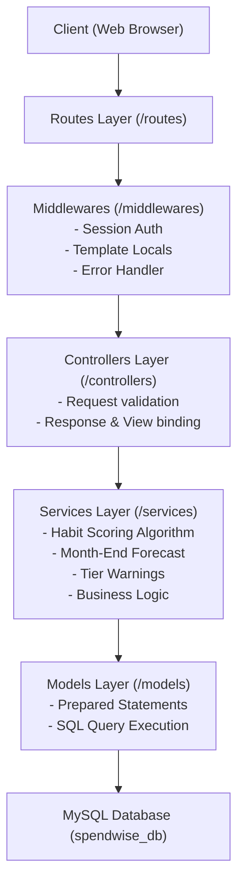

# 📋 SpendWise 프로젝트 계획서 (PROJECT_PLAN.md)

---

## 1. 프로젝트 개요 및 기획 배경

### 1.1 프로젝트 명칭
**SpendWise (스펜드와이즈) — 개인 소비습관 정밀 분석 및 자산 관리 핀테크 웹 플랫폼**

### 1.2 기획 배경 및 문제 정의
현대 소비자는 간편결제(네이버페이, 카카오페이 등), 신용카드, 배달앱의 보편화로 인해 **자신의 소비 통제력을 상실**하는 현상을 빈번히 겪고 있습니다.
1. **수동적 가계부의 한계**: 기존 가계부는 단순 입출금 기록에 그쳐, "내가 잘 소비하고 있는지"에 대한 객관적인 진단을 제공하지 못합니다.
2. **소액 반복 결제의 누수**: 4,500원짜리 커피나 배달팁 같은 '티끌 지출'은 개별로는 부담이 적어 보이지만, 한 달이 지나면 수십만 원의 심각한 자금 누수를 유발합니다.
3. **사후적 예산 초과**: 월말이 되어서야 카드 명세서를 보고 깜짝 놀라는 사후적 통제로는 과소비를 예방할 수 없습니다.

### 1.3 해결책 및 핵심 목표
- **실제 MySQL 거래 원장 기반 실시간 분석**: 임의의 난수나 가짜 통계를 철저히 배제하고, 실제 입력된 금융 데이터를 바탕으로 산출.
- **100점 만점 소비습관 점수 및 4대 평가 영역 근거 제시**: 예산 준수도(35점), 저축률(25점), 과소비 억제도(20점), 소액결제 관리(20점)로 구성된 체계적 스코어링.
- **선제적 3단계 예산 경고(70%·90%·100%)**: 한도 소진율에 따라 시각적 배너와 경고를 발동하여 지출 속도 자제 유도.
- **월말 예상 지출 수학적 추정 모델**: 일평균 지출액과 잔여 일수를 연동하여 이번 달 최종 지출액을 과학적으로 사전 예측.
- **과소비 및 반복 소액결제 탐지**: 고액 단일 지출과 잦은 소액 지출을 자동 분류하여 개선점을 명확히 피드백.

---

## 2. 시스템 아키텍처 및 설계 원칙

### 2.1 계층화 아키텍처 (Layered Architecture)
본 프로젝트는 단일 책임 원칙(SRP)과 관심사 분리(SoC)를 위해 엄격한 5계층 아키텍처로 설계되었습니다.



1. **Routes (`routes/`)**: URL 엔드포인트와 HTTP 메서드 매핑 및 미들웨어 체인 연결.
2. **Middlewares (`middlewares/`)**: 세션 기반 인증 가드, 전역 EJS 포맷팅 헬퍼 주입, 중앙 에러 제어.
3. **Controllers (`controllers/`)**: 클라이언트 입력 검증, 서비스 레이어 호출, 결과 데이터를 EJS 뷰에 바인딩.
4. **Services (`services/`)**: 핵심 비즈니스 로직 및 수학적 분석 알고리즘 구현 (재무 진단, 예산 경고, 예측 계산).
5. **Models (`models/`)**: MySQL2 커넥션 풀을 활용하여 Prepared Statement 기반의 쿼리 수행 및 엔티티 반환.

### 2.2 보안 및 신뢰성 원칙
- **비밀번호 단방향 암호화**: `bcrypt` (Salt Rounds 10) 적용을 통해 비밀번호 원문은 메모리와 DB에 절대 평문으로 저장되지 않음.
- **SQL Injection 원천 방지**: 모든 동적 쿼리에 MySQL2의 파라미터화된 쿼리 (`pool.execute('... WHERE id = ?', [id])`) 사용.
- **다중 사용자 데이터 격리**: 모든 데이터 조회/수정/삭제 쿼리에 `WHERE user_id = ?` 조건을 필수 강제하여 타 사용자 데이터 접근 차단.
- **세션 기반 상태 관리**: `express-session`의 `httpOnly: true` 쿠키 속성으로 XSS 공격을 통한 세션 탈취 방지.
- **환경 변수 격리**: 민감 정보(DB 비밀번호, 세션 시크릿 등)는 `.env`로 외부화하여 소스코드 유출 시에도 안전 보장.

---

## 3. 핵심 알고리즘 및 계산 모델

### 3.1 월말 예상 지출 계산 모델 (Month-End Forecast Formula)
단순한 추측이 아닌, 당월 경과 일수($D$)와 월 전체 일수($T$), 현재까지의 총 지출액($E$)을 수학적으로 외삽합니다.

$$\text{일평균 지출액 (Daily Average)} = \frac{E}{\max(1, D)}$$
$$\text{월말 예상 최종 지출액} = E + \left(\text{Daily Average} \times \max(0, T - D)\right)$$

*특징: 과거 월 조회 시에는 실제 최종 지출액이 그대로 표시되며, 당월 조회 시에는 잔여 일수를 반영한 예측 지출액이 실시간 변동 산출됩니다.*

### 3.2 소비 습관 100점 만점 평가 모델 (100-Point Scoring Model)

총점은 4대 핵심 재무 영역의 가중 합산으로 결정됩니다 ($35 + 25 + 20 + 20 = 100\text{점}$):

| 평가 영역 | 배점 | 채점 기준 및 로직 | 세부 득점 구간 |
|---|---|---|---|
| **1. 예산 준수도** | 35점 | 예산 대비 실제 지출 소진율 | $\le 70\%: 35\text{점}$<br>$70 \sim 85\%: 30\text{점}$<br>$85 \sim 100\%: 22\text{점}$<br>$100 \sim 115\%: 12\text{점}$<br>$> 115\%: 5\text{점}$ |
| **2. 저축/잉여율** | 25점 | $\frac{\text{수입}-\text{지출}}{\text{수입}} \times 100$ | $\ge 35\%: 25\text{점}$<br>$25 \sim 35\%: 21\text{점}$<br>$15 \sim 25\%: 16\text{점}$<br>$5 \sim 15\%: 10\text{점}$<br>$0 \sim 5\%: 5\text{점}$<br>$< 0\%\text{(적자)}: 0\text{점}$ |
| **3. 과소비 억제도** | 20점 | 단일 지출 $\ge$ 기준금액(10만원) 발생 건수 | $0\text{건}: 20\text{점}$<br>$1\text{건}: 16\text{점}$<br>$2\text{건}: 12\text{점}$<br>$3 \sim 4\text{건}: 7\text{점}$<br>$\ge 5\text{건}: 2\text{점}$ |
| **4. 소액 반복 결제 관리** | 20점 | 잦은 소액 지출 $\le$ 기준금액(1만원) 누적 횟수 | $\le 5\text{회}: 20\text{점}$<br>$6 \sim 10\text{회}: 16\text{점}$<br>$11 \sim 15\text{회}: 12\text{점}$<br>$16 \sim 25\text{회}: 7\text{점}$<br>$\ge 26\text{회}: 2\text{점}$ |

**종합 등급 분류**:
- **최우수 (S 등급)**: 90점 이상
- **우수 (A 등급)**: 80 ~ 89점
- **양호 (B 등급)**: 70 ~ 79점
- **주의 (C 등급)**: 60 ~ 69점
- **위험 (D 등급)**: 60점 미만

### 3.3 예산 3단계 경고 모델
사용률 $R = \frac{\text{실제 지출}}{\text{설정 예산}} \times 100(\%)$
- $R < 70\%$: `안정 단계 (Safe, 녹색)`
- $70\% \le R < 90\%$: `주의 단계 (Warning 70%, 노란색)`
- $90\% \le R < 100\%$: `경고 단계 (Warning 90%, 주황색)`
- $R \ge 100\%$: `초과 위험 (Danger 100%, 적색)`

---

## 4. 데이터베이스 설계 요약

```text
spendwise_db
├── users (회원 프로필, 암호화 패스워드, 월 목표 소득, 과소비/소액 탐지 임계치)
├── categories (수입/지출 분류 항목, 아이콘, 대표 HEX 색상, 시스템/커스텀 구분)
├── transactions (금융 거래 원장, 금액, 일자, 고정비 여부, 결제수단, 복합 인덱스)
├── budgets (월 전체 총예산 및 카테고리별 개별 예산, UNIQUE 복합키)
├── analysis_reports (월별 소비습관 진단 결과, 100점 점수, 4대 평가 JSON 보존)
└── saving_goals (절약 챌린지, 목표 금액, 현재 달성액, D-day, 달성 상태)
```

---

## 5. 개발 단계별 마일스톤 및 결과

| 단계 | 주요 작업 내용 | 산출물 및 상태 |
|---|---|---|
| **Phase 1** | 기존 환경 점검 및 불필요 파일 정리 | EC2 MariaDB 및 node_modules 확인 완료 |
| **Phase 2** | 데이터베이스 스키마 및 ERD 설계 | `database/schema.sql`, `docs/ERD.md` 작성 완료 |
| **Phase 3** | DB 구축 및 사실적 시드 데이터 적재 | `database/seed.sql` 실행 (42건 거래, 예산, 챌린지) |
| **Phase 4** | 백엔드 모델, 서비스, 컨트롤러, 라우터 구축 | 계층형 MVC 구조 완성, 100% Prepared Statements |
| **Phase 5** | 핀테크 다크모드 UI 및 Chart.js 시각화 구현 | EJS 템플릿, CSS 및 차트 렌더링 스크립트 작성 |
| **Phase 6** | 종합 자동화 단위·통합·HTTP 엔드포인트 테스트 | **22개 단위/통합 테스트 + 11개 HTTP 테스트 100% 통과** |
| **Phase 7** | 최종 문서화 및 발표 자료 작성 | `README.md`, `PROJECT_PLAN.md`, `PRESENTATION.md` |
